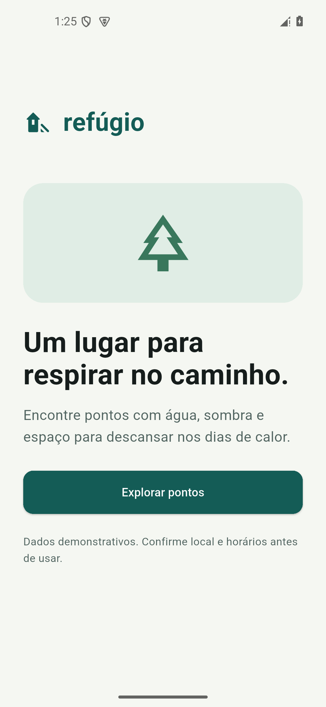
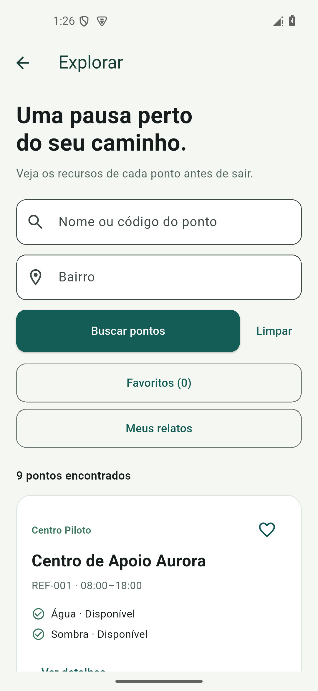
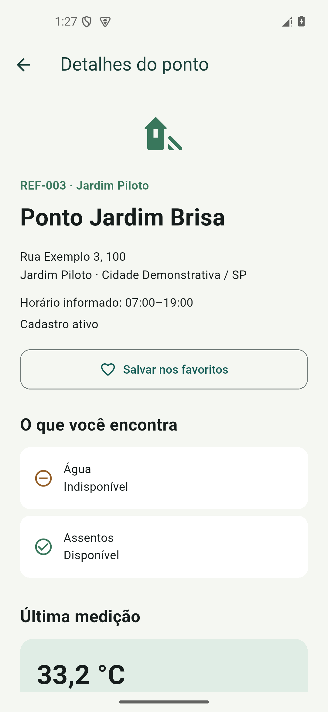
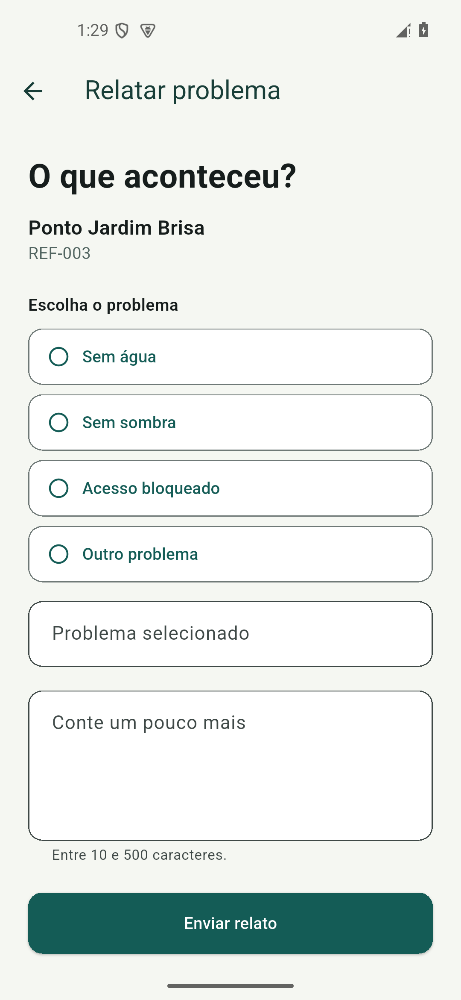
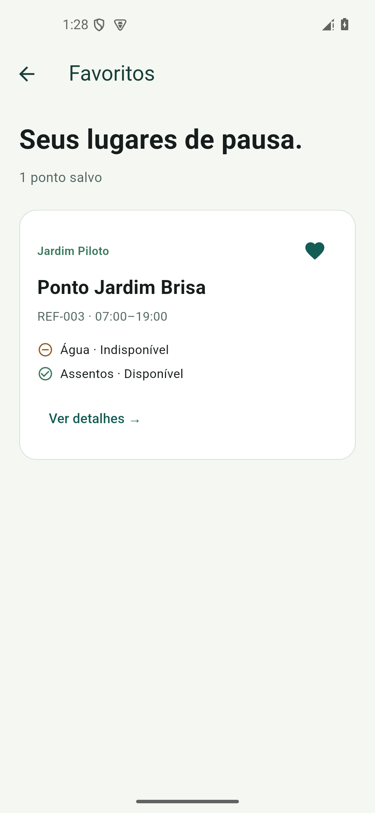

# Refúgio

Um lugar para respirar no caminho.

O Refúgio reúne pontos com água, sombra, assentos e acessibilidade para quem precisa de uma pausa nos dias de calor. Atende principalmente cidadãos em deslocamento, idosos e pessoas que trabalham ao ar livre.

Projeto desenvolvido em Flutter para a Global Solution 2026/2 da FIAP, na disciplina Mobile Application Development. Tema: CitizenTech.

## Equipe

Grupo Refúgio · Turma 2TDSPB

| Integrante | RM |
| --- | --- |
| Gabriel Stuani | 566682 |
| Guilherme Soares | 568227 |
| Luiz Kichimoto Valdevino | 567726 |
| Luis Fillipe Rodrigues Seripieri | 567918 |
| Gabriel Rocha de Souza | 567023 |

## Como funciona

1. **Boas-vindas:** apresenta a proposta e abre o catálogo.
2. **Explorar:** lista os pontos ativos, com busca por nome ou código e filtro por bairro.
3. **Detalhes do ponto:** mostra endereço, horário, recursos e a última medição. Permite favoritar.
4. **Relatar problema:** formulário com categoria e descrição validadas.
5. **Favoritos:** reúne os pontos salvos e permite removê-los.
6. **Meus relatos:** mostra os relatos enviados e o ponto de cada um.

Os dados são fictícios e ficam em memória: favoritos e relatos reiniciam ao fechar o aplicativo. Para testar, procure **REF-003 — Ponto Jardim Brisa**.

## Telas

| Boas-vindas | Explorar | Detalhes |
| --- | --- | --- |
|  |  |  |

| Relatar problema | Favoritos |
| --- | --- |
|  |  |

## Executar

Com Flutter, Android SDK e um emulador ou aparelho Android configurados:

```bash
flutter pub get
flutter devices
flutter run -d ID_DO_DISPOSITIVO
```

Substitua `ID_DO_DISPOSITIVO` pelo identificador listado em `flutter devices`.

## Gerar APK

```bash
flutter build apk --release
```

O APK é gerado em `build/app/outputs/flutter-apk/app-release.apk`. A versão publicada está em [Releases](https://github.com/Gstuani/refugio/releases/tag/v1.0.0).

## Estrutura

```text
lib/
  main.dart        # Entrada do aplicativo e tema
  models/          # Ponto, recurso, medição e ocorrência
  repositories/    # Dados de demonstração e favoritos
  pages/           # Seis telas
  widgets/         # Item da lista de pontos
```

As telas recebem dados pelo construtor e usam `StatefulWidget` com `setState`. O formulário usa `Form`, `GlobalKey<FormState>` e `TextFormField`.

## ODS relacionados

- **ODS 3 — Saúde e bem-estar:** facilita encontrar água, sombra e descanso.
- **ODS 10 — Redução das desigualdades:** considera quem tem menos opções de proteção durante o deslocamento.
- **ODS 11 — Cidades e comunidades sustentáveis:** organiza informações sobre recursos urbanos de apoio ao cidadão.
- **ODS 13 — Ação contra a mudança global do clima:** responde a dificuldades do dia a dia em períodos de calor intenso.

## Demonstração

Vídeo no YouTube: [link](https://youtu.be/gJrLOqEMqxc)

## Referências

- [App de lista das aulas](https://github.com/2TDSPB-MOBILE/app_lista)
